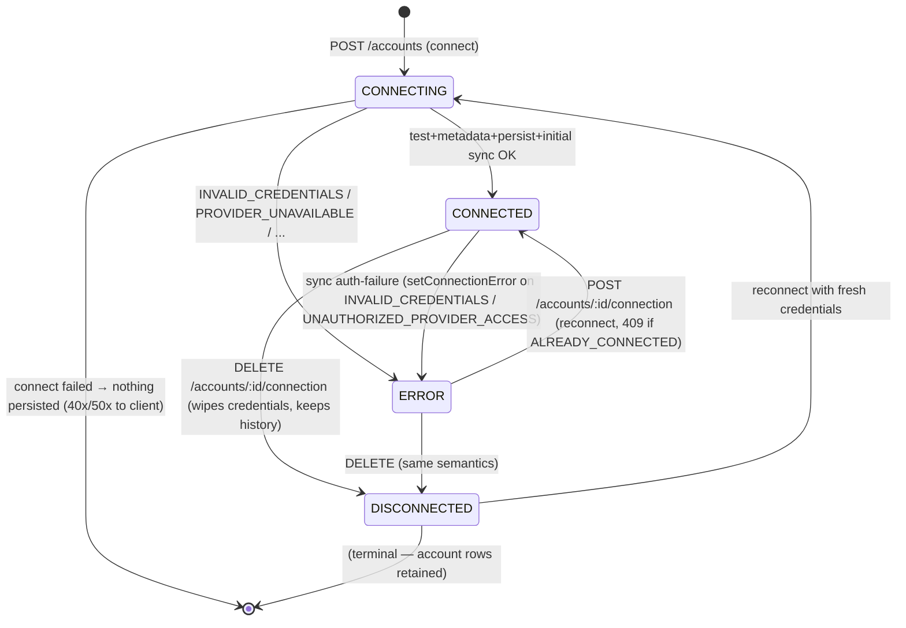

# Accounts & Trading Connectivity — Domain Contracts

**Phase 01 deliverable (B of 5).** Provider-neutral domain contracts, state machines, and data semantics. Contracts marked **[EXISTS]** are live code today (`packages/shared/src/schemas/trading-account.ts`, verified path:line); contracts marked **[PROPOSED]** are the frozen design for the next implementation phase, written here so Phase 02+ engineers never invent missing semantics. Per the Phase 01 mandate §19, **no new shared code was written in this phase** — rationale in the final report; the [PROPOSED] shapes land with the first real adapter that consumes them.

Runtime validation is **zod** (repo standard — no new validation library); types are inferred from schemas (`z.infer`). Identifier, timestamp, and decimal primitives are reused from `packages/shared/src/schemas/primitives.ts` (`uuidSchema`, `isoDateTimeSchema`, `decimalStringSchema`).

---

## 1. Domain Terminology

| Term | Meaning | Not to be confused with |
|---|---|---|
| **Provider** | A supported integration identity (adapter + descriptor), e.g. `oanda-rest-v20`, `mock` | A broker brand (IC Markets is a broker reached *through* platforms) |
| **Platform / mechanism** | The technical connection channel (MT5 terminal, cTrader Open API, REST v20, WebSocket) | The provider brand |
| **Connection** | The authenticated link between an Euforia user and a provider configuration (holds encrypted credentials) | Account metadata |
| **External trading account** | A provider-side trading account registered in Euforia (identity + display metadata) | A journal account (the `Account` catalog contract is a different, journal-domain concept) |
| **Snapshot** | One observation of external account state (balance/equity/margin…) at a time | The account itself; a history (none is kept today) |
| **External position** | A provider-observed position (open or historical, per provider semantics) | A journal trade |
| **External order** | A provider-reported order (pending/filled/canceled…) | An execution; an order is not a fill |
| **External deal** | A provider-reported fill/execution (MT5 "deal") | A position (several deals can build one position) |
| **Journal trade (canonical)** | Euforia's own `Trade` entity, journal domain | Any external record — external records never auto-create journal trades |
| **Sync run** | One bounded synchronization attempt over one account | Connection state |
| **Freshness** | How current the *persisted* external state is (axis separate from connection) | Connection status |
| **Capability** | What a provider/mechanism actually supports, with an evidence-backed support level | What an interface method exists |

---

## 2. Core Domain Concepts (with ownership)

Concepts, owners, invariants, and relationships are frozen in doc A §6.1 (the mandate's required boundary table). Summary of the five things this document adds semantics for:

1. **Connection lifecycle** (§3.1) — can Euforia authenticate with the provider *right now*?
2. **Synchronization lifecycle** (§3.2, §8) — how fresh is the *persisted* external state?
3. **Capability support** (§4) — what can this provider honestly do?
4. **Data representation** (§5-§7) — how do snapshots, positions, orders, deals look on the wire?
5. **Identity & idempotency** (§12) — what makes an external record the same record twice?

---

## 3. State Machines and Permitted Transitions

### 3.1 Connection lifecycle **[EXISTS enum; transitions now specified]**

Enum **[EXISTS]**: `tradingConnectionStatusSchema = DISCONNECTED | CONNECTING | CONNECTED | ERROR` (`trading-account.ts:42-47`).

The mandate's suggested vocabulary (`PENDING`, `VALIDATING`, `DEGRADED`, `REAUTH_REQUIRED`) is **not adopted** where existing semantics already cover it — per mandate §8.2 ("do not include a state solely because it appears in this list"). Mapping rationale: `PENDING`/`VALIDATING` → transient phases of `CONNECTING` (connect is a single atomic use-case in code; no durable PENDING row is ever stored); `DEGRADED` → a *freshness/sync* condition, not a connection condition (kept on the sync axis); `REAUTH_REQUIRED` → `ERROR` with `errorCode: INVALID_CREDENTIALS` (a re-auth prompt is a UI reading of that precise error, not a new backend state). **Verified evidence:** connect runs test→metadata→persist→initial-sync in one use-case (`trading-account.service.ts`), so no intermediate state is observable or storable today; introducing durable intermediate states would be speculative.



Rules:
- A **provider outage must not** move a connection out of `CONNECTED` — outages degrade the *sync* axis (§3.2). Only auth-class failures (`INVALID_CREDENTIALS`, `UNAUTHORIZED_PROVIDER_ACCESS`) write `ERROR` on the connection (verified: `failSyncRun` + `setConnectionError` path, `trading-sync.service.ts`).
- `ERROR` is recoverable (reconnect). `DISCONNECTED` is terminal for the connection row; the account and all imported history are preserved (`tradingDisconnectResponseSchema.historyPreserved: literal true`).
- **[PROPOSED Phase 02]** — no new states; if OAuth arrives (Phase 04), `ERROR` + `errorCode: INVALID_CREDENTIALS` + a `reauthRequired` boolean *view field* expresses the reauth prompt without touching the state machine.

### 3.2 Synchronization lifecycle **[EXISTS enums; semantics completed]**

Sync-axis status **[EXISTS]**: `synchronizationStatusSchema = UNKNOWN | SYNCING | LIVE | DELAYED | STALE | ERROR` (`trading-account.ts:54-61`). Run status **[EXISTS]**: `tradingSyncRunStatusSchema = RUNNING | COMPLETED | PARTIAL | FAILED` (:65-71). Trigger **[EXISTS]**: `INITIAL | MANUAL` (:74-75).

- Derivation **[EXISTS]**: `deriveSynchronizationStatus(lastSyncAt, latestRun, now, freshnessTtlMs = 15min)` → `SYNCING` while a run is RUNNING; `LIVE` if last successful sync < TTL; `STALE` beyond TTL; `UNKNOWN` if never synced; `ERROR` if last attempt failed (`mappers.ts:84-106`, unit-tested truth table 9/9).
- **`DELAYED` [PROPOSED Phase 04]**: produced when a *scheduled* sync (which does not exist yet — no scheduler in the build) misses its expected interval but is still within the stale TTL. Reserved today; producing it before a scheduler exists would be dishonest.
- **`PARTIAL` [PROPOSED Phase 03]**: a run that completed ≥1 segment and had ≥1 segment fail (see §8.2). Exists in the enum, never produced yet — an honest gap the audit flagged.

### 3.3 Permitted-transition summary (for implementers)

| Axis | Who may write it | How |
|---|---|---|
| Connection status | `TradingAccountService` only, via connect/reconnect/disconnect/failSyncRun auth paths | Never client input; never derived from `lastSyncAt` |
| Sync-axis status | Mapper, derived from observable facts only (`lastSyncAt`, latest run, clock) | Never stored as mutable user data |
| Run status | `TradingSyncService` only | `RUNNING` created by DB-guarded `startRun`; completion in the same transaction as the write-set |

---

## 4. Provider Identity and Capability Contracts

### 4.1 Provider identity **[EXISTS]** — `ProviderDescriptor`

`tradingProviderDescriptorSchema` (`trading-account.ts:111-123`): `providerId` (stable machine id, e.g. `"oanda-v20"` — never a display name), `providerName` (human label), `platform` (broker/platform family enum), `supportedEnvironments` (DEMO/LIVE/PROP_FIRM), `supportedConnectionMethods` (currently `["API_KEY"]`), `supportedPermissions` (READ_* only), `capabilities`, `isMock`. **Rule:** display labels are presentation; `providerId` is the only identity used in routes, rows, and registry keys.

Brand vs mechanism rule (mandate §8.1): one adapter per *technical mechanism*, not per brand — `IC Markets via cTrader` is served by the cTrader adapter; two brokers on MT5 share the MT5 bridge mechanism. Providers are declared in code (registry), not in the DB — verified today and kept.

### 4.2 Capability contract — **[PROPOSED extension, frozen design]**

The existing 6-boolean `tradingProviderCapabilitiesSchema` cannot express `UNKNOWN` or conditional support (mandate §7.3/§9.3 explicitly forbids collapsing everything to booleans). Target design (zod, to be added to `trading-account.ts` in Phase 03 **when the OandaAdapter consumes it**):

```ts
// [PROPOSED Phase 03] capability support levels — replaces the 6 booleans
// (booleans remain readable via helpers during migration; adapters migrate one by one)
export const capabilitySupportSchema = z.enum(["SUPPORTED", "UNSUPPORTED", "UNKNOWN"]);

export const providerCapabilitySchema = z.object({
  support: capabilitySupportSchema,
  /** How the capability is exercised, when SUPPORTED. */
  retrieval: z.enum(["POLL", "STREAM", "POLL_AND_STREAM", "ON_CONNECT"]).optional(),
  /** Required connection-level permissions, e.g. ["READ_POSITIONS"]. */
  requiresPermissions: z.array(tradingProviderPermissionSchema).optional(),
  /** Evidence anchor: official docs section or Phase 00 audit reference. */
  evidence: z.string().optional(),
  /** Honest limitation text shown by the UI when relevant. */
  limitation: z.string().optional(),
});

export const tradingProviderCapabilitiesV2Schema = z.object({
  accountDiscovery:  providerCapabilitySchema,
  accountMetadata:   providerCapabilitySchema,
  balanceEquity:     providerCapabilitySchema,
  marginInfo:        providerCapabilitySchema,
  openPositions:     providerCapabilitySchema,
  orders:            providerCapabilitySchema,
  deals:             providerCapabilitySchema,
  historyDepth:      providerCapabilitySchema,   // historical records scope
  streamingAccountUpdates:   providerCapabilitySchema,
  streamingPositions:        providerCapabilitySchema,
  streamingOrderDealUpdates: providerCapabilitySchema,
  connectionValidation:      providerCapabilitySchema,
  credentialRevocation:      providerCapabilitySchema,
});

/** Connection-scoped (not global) capability override — conditions like
 *  region, subscription, or account permissions attach HERE, per mandate §9.3. */
export const connectionCapabilityOverrideSchema = z.object({
  capability: z.string(),            // key of tradingProviderCapabilitiesV2Schema
  support: capabilitySupportSchema,
  reason: z.string(),                // e.g. "practice accounts expose no order history"
});
```

Rules already frozen by doc A §4.4: `UNKNOWN` is never coerced to `false`/`true`; calling an operation whose capability is not `SUPPORTED` throws `UNSUPPORTED_CAPABILITY` **[PROPOSED error code, doc §10]**; `TEMPORARILY_UNAVAILABLE` is an *operational* state and lives on the sync/error axis, never inside a capability declaration.

### 4.3 Adapter result and error semantics **[EXISTS pattern; table now normative]**

The adapter pattern is: **return data, or throw sanitized `ProviderError`** (`provider.types.ts:117-133`). No result envelope (rationale: doc A §9). The normative mapping:

| Outcome | Adapter behavior | Normalized to | Retryable? | User action? |
|---|---|---|---|---|
| Success with records | return array/object | 200-family wire view | — | — |
| Success, zero records | return `[]` (empty array ≠ error) | 200 with empty list | — | — |
| Partial result | **[PROPOSED]** throw nothing; return segment data + run ends `PARTIAL` (§8.2) | `PARTIAL` run + per-segment error codes | segment yes | no |
| Unsupported operation | throw `ProviderError("UNSUPPORTED_CAPABILITY", ...)` **[PROPOSED code]** | 422 | no | pick another provider/plan |
| Authentication failure | `INVALID_CREDENTIALS` | 422 + connection `ERROR` | no | fix credentials / reconnect |
| Authorization/permission failure | `UNAUTHORIZED_PROVIDER_ACCESS` | 502 + connection `ERROR` | no | check account permissions |
| Rate limiting | `RATE_LIMITED` | 429 + `Retry-After` | yes, after backoff | no |
| Temporary provider outage | `PROVIDER_UNAVAILABLE` | 502 | yes, backoff | no |
| Invalid/expired cursor | **[PROPOSED Phase 04]** `SYNC_CURSOR_INVALID` | 502 + run FAILED + cursor reset policy (§8.3) | yes (full refresh) | no |
| Malformed response | `INVALID_PROVIDER_RESPONSE` | 502 | yes (transient parse issues) | report if persistent |
| Unrecoverable provider error | `SYNC_FAILED` | 502 | no | contact support |
| Timeout | `CONNECTION_TIMEOUT` (via `withProviderTimeout`) | 502 | yes | no |

Errors are never swallowed and never mapped to empty arrays (mandate §9.5; verified discipline in `normalization.ts` + error-mapper unit tests 19/19).

### 4.4 Connection methods **[EXISTS enum; extension points frozen]**

`tradingConnectionMethodSchema = ["API_KEY"]` today. **[PROPOSED]** future values, declared only when a real adapter requires them (the schema comment already mandates this — `trading-account.ts:79-84`): `OAUTH_AUTHORIZATION_CODE` (cTrader, Phase 05 — brings refresh-token persistence + callback design gates), `PLATFORM_BRIDGE` (MT5, Phase 06, pending user decision). Credentials transport stays `{ method, secret }` (`tradingCredentialsInputSchema`); OAuth token bundles will use a separate input schema, **not** a widening of `secret`.

### 4.5 Raw payload retention **[DECISION: not persisted]**

Raw provider payloads are not retained (mandate §9.6 data-minimization). If a debugging mode is ever justified: redaction of credentials/PII, TTL-based retention, size caps, access restricted to operators, never exposed to the frontend — designed then, not now.

---

## 5. Connection and External Account Contracts **[EXISTS]**

Wire shapes today (all in `trading-account.ts`, reused verbatim — no rename, per mandate §10):

- `tradingConnectionViewSchema` — `status`, `method`, `permissions`, `credentialsHint` (masked only), `lastConnectedAt`, `lastSyncAt`, `lastError` (sanitized). **No credentials, no tokens, ever.**
- `tradingAccountDetailsSchema` — identity (`id`, `userId`, `name`, `type` (environment), `broker`, `currency`, `startingBalance`, `isDefault`, `propConfig`), `externalAccountId`, embedded `provider` descriptor, `connection?`, `synchronization`, `snapshot?`, timestamps. Serves as the `ExternalAccountSummary`.
- Inputs: `tradingAccountConnectInputSchema` (providerId, environment, externalAccountId, displayName?, credentials), `tradingReconnectInputSchema`, `tradingAccountUpdateInputSchema` (rename only).
- Responses: `tradingAccountDetailsResponseSchema`, `tradingProviderListResponseSchema`, `tradingConnectionTestResponseSchema` (4 named checks, honest per-check results), `tradingDisconnectResponseSchema` (`historyPreserved: true`).

Missing-field semantics: `connection` is `null` when never connected; `lastError` is sanitized provider-free text; there is no client-writable field besides `name` (D2, doc A §4.2).

---

## 6. Account Snapshot Contract **[EXISTS]**

`tradingAccountSnapshotViewSchema` (`trading-account.ts:205-215`): `balance`, `equity`, `unrealizedPnl`, `margin`, `freeMargin`, `marginLevel` — each `decimalStringSchema.nullable()` — plus `currency`, `syncedAt`.

Distinguishing the five value states (mandate §8.4):

| State | Representation | Never do |
|---|---|---|
| Numeric zero | `"0"` / `"0.00000000"` | coerce zero to null |
| Missing (provider returned nothing) | `null` | invent a zero or empty string |
| Unsupported by provider | `null` + capability `UNSUPPORTED` on the corresponding capability (§4.2) | fabricate a plausible value |
| Stale | value stays as last synced; *freshness axis* (§9) says STALE | mutate the value |
| Source/timestamp unknown | cannot occur for snapshots (every snapshot has `syncedAt` + `syncRunId` provenance) — a payload without provenance fails normalization | persist unprovenanced data |

Adapter-side shape: `NormalizedSnapshot` (`provider.types.ts:52-58`) → validated by `normalizedSnapshotSchema` (`normalization.ts:26-32`) → persisted latest-only → wire view. History series: **DEFER** (product decision open, doc A §10 R3).

---

## 7. Position, Order, and Deal Contracts **[EXISTS]**

### 7.1 Positions

Adapter: `NormalizedPosition` (`provider.types.ts:61-75`); wire: `brokerPositionSchema` inside `tradingPositionsResponseSchema` (§ comment: "Positions / orders reuse the Session-Live broker schemas verbatim"). Fields: `externalPositionId` (required — but §7.4 records the fallback when a provider lacks stable ids), `symbol`, `side: BUY|SELL`, `volume`, `entryPrice`, nullable floating fields (`currentPrice`, `stopLoss`, `takeProfit`, `profit`, `swap`, `commission`), `openedAt` (provider time, UTC ISO).

Netting vs hedging (mandate §8.5): the model does **not** assume a stable 1:1 position lifecycle. MT5 netting links deals→`positionId`; hedging accounts may expose multiple concurrent positions per symbol — both are representable because `TradingPosition` rows are keyed by `(accountId, externalPositionId)` and never derived from symbol aggregation.

### 7.2 Orders

`NormalizedOrder` (:78-91) + `brokerOrderSchema`: `externalOrderId`, `symbol`, `type` (broker verb, e.g. `"BUY_LIMIT"`, preserved verbatim — provider status codes are **not** collapsed), `volume`, `price`, SL/TP nullable, `status` (string, provider-verbatim), `createdAt`/`updatedAt` nullable. Status normalization rule (mandate §10.4): only statuses with a reliable common meaning are ever mapped in *views*; the raw provider status always survives in `status`, and unknown future statuses pass through verbatim — never silently converted to `OPEN`/`CLOSED`.

### 7.3 Deals

`NormalizedDeal` (:97-110) + `tradingDealSchema` (`trading-account.ts:298-310`): `externalDealId`, `symbol` **nullable** (balance operations have none — documented at :297), `side`, `volume`, `price/profit/commission/swap` nullable, `positionId` nullable (MT5 netting link), `executedAt`. Deals are the *only* external record that may feed canonical trade reconstruction, and only through `TradeReconstructionService` (idempotent, skips already-journaled deals, never resurrects soft-deleted trades — verified).

### 7.4 Identity fallback when a provider lacks stable ids

**Rule [PROPOSED, applies per adapter]:** if a provider does not expose a stable identifier for a record type, the adapter MUST (a) declare the corresponding capability with an honest `limitation` string, (b) use the provider's documented composite key if one exists, and (c) otherwise treat those records as **non-idempotent observations with `UNSUPPORTED` upsert semantics** — i.e. they may be displayed as transient view data but are not persisted as canonical external records. No universal fingerprint is invented (mandate §10.5); each adapter documents its fallback explicitly in its contract tests.

---

## 8. Synchronization Contracts

### 8.1 Sync run view **[EXISTS]** — `SyncRunSummary`

`tradingSyncRunViewSchema` (`trading-account.ts:183-195`): `id`, `status`, `trigger`, `startedAt`, `finishedAt?`, `durationMs?`, `positionsUpserted/ordersUpserted/dealsUpserted`, `errorCode?`. `tradingSynchronizationViewSchema` (:197-202) = `{ status, lastSyncAt?, lastRun? }`. `tradingAccountSyncResponseSchema` (:273-278) returns the post-sync view + run.

### 8.2 Full vs partial success **[PROPOSED Phase 03]**

- **Full success:** every declared-and-supported segment (snapshot, positions, orders, deals) succeeded → run `COMPLETED` with counts (today's behavior).
- **Partial success:** ≥1 supported segment succeeded AND ≥1 supported segment failed → run `PARTIAL`; `errorCode` records the *first* failing segment's code; counts reflect what persisted. The account's `lastSyncAt` advances **only for segments that persisted** — implementation: segment timestamps on the run (new columns) or per-segment sync-state rows (design decision at Phase 03 implementation, both shapes preserved by the existing wire view).
- A failing *unsupported* segment is not a partial failure — it is a capability fact (§4.2) and never marks the run FAILED.
- Partial ≠ success in freshness (§9): a partial run yields `DELAYED`-grade freshness messaging, never `LIVE`, until a full run completes.

### 8.3 Cursors / watermarks **[PROPOSED Phase 04, conditional]**

Default posture: **full refresh per run** (today's verified behavior — idempotent, simple, honest). A cursor entity is created **only** if a chosen provider's history endpoints require incremental pagination (candidate: OANDA transaction pages are bounded; Deriv WS pushes; MT5 bridge is full-poll). If created: owned by the Accounts domain, keyed `(accountId, scope)` where `scope` ∈ `{deals, orders, ...}` — cursors are never globally interchangeable across providers or endpoints (mandate §8.9). Expired/invalid cursor → `SYNC_CURSOR_INVALID` → automatic policy: reset cursor, run one full refresh, resume incremental after.

### 8.4 Idempotency and recovery matrix (mandate §11.4)

| Situation | Behavior |
|---|---|
| Same deal fetched twice | single row — upsert keyed `(accountId, externalDealId)` (verified by e2e) |
| History page fetched again | same keys → same single rows; counts may re-report, rows dedupe |
| Streaming event delivered twice | same upsert path (future Phase 05+ consumers) |
| Events out of order | last write wins per record; `executedAt`/`openedAt` preserved from source, so ordering is reconstructable; run counts unaffected |
| Cursor expires | §8.3 policy (reset + full refresh) |
| Sync run crashes | `RUNNING` row remains → next start attempt hits the partial unique index → 409 `SYNC_ALREADY_RUNNING`… **[GAP — PROPOSED Phase 04]**: a startup/reaper marks runs `FAILED` when their process is gone (today the single-runner guard makes a crashed run block until a manual sweep; acceptable for user-triggered-only sync, must be fixed before a scheduler exists) |
| Provider dies mid-pagination | segments already persisted stay; run FAILes (or PARTIAL once §8.2 ships); retry re-runs idempotently |
| Partial sync then later segment fails | §8.2 PARTIAL; freshness messaging degrades until full run |

---

## 9. Freshness and Data Provenance **[EXISTS + PROPOSED thresholds]**

- **Four timestamps, always distinguished** (mandate §10.3): provider *event time* (`executedAt`, `openedAt` — source-preserved), provider *observation time* (sync time of the record — `syncedAt`), Euforia *ingestion time* (row `createdAt`), and *last successful synchronization* (`lastSyncAt` / `lastRun.finishedAt`). Canonical wire format: **UTC ISO 8601** (`isoDateTimeSchema`) — consistent with the whole application. Provider-original timestamps are never discarded.
- **Freshness levels** (derived, never stored): `SYNCING` → `LIVE` (≤ TTL) → `DELAYED` [Phase 04] → `STALE` → `UNKNOWN`/`ERROR` (§3.2).
- **Provider-aware thresholds [PROPOSED Phase 04]:** replace the single hardcoded 15-min TTL (`mappers.ts:96`) with a per-connection TTL resolved from the provider descriptor (e.g. polling MT5 bridge: 15-60 min; OANDA REST: 5-15 min; streaming provider: streaming-heartbeat-based). Thresholds configurable via env with honest defaults; a polling provider's data is never labeled "real-time".
- **Provenance on every record:** external ids, `syncRunId`, `syncedAt`, source timestamps — already in place (verified wire contracts) and mandatory for any future record type.

---

## 10. Error Semantics **[EXISTS]**

- Adapter layer: `ProviderError` with exactly 7 codes (`provider.types.ts:119-126`); messages **sanitized** (no credentials, no raw provider internals — mandate §9.5).
- Wire layer: 13 stable `TRADING_ERROR_CODES` with documented HTTP mapping (`trading-account.ts:323-350`): 422 client-fixable (`INVALID_CREDENTIALS`, `UNSUPPORTED_PROVIDER`, `NOT_CONNECTED`), 409 conflicts (`SYNC_ALREADY_RUNNING`, `DUPLICATE_ACCOUNT`, `ALREADY_CONNECTED`), 429 (`RATE_LIMITED` + `Retry-After`), 502 provider-side (`PROVIDER_UNAVAILABLE`, `CONNECTION_TIMEOUT`, `UNSUPPORTED_ACCOUNT`, `UNAUTHORIZED_PROVIDER_ACCESS`, `SYNC_FAILED`, `INVALID_PROVIDER_RESPONSE`).
- **[PROPOSED Phase 03]**: add `UNSUPPORTED_CAPABILITY` (422) and `SYNC_CURSOR_INVALID` (502) to the table when their producers ship (§4.2, §8.3). Adding codes is additive; consumers must treat unknown codes as 502-class (documented consumer rule).
- Unknown future provider statuses never map onto misleading canonical values (§7.2); malformed → `INVALID_PROVIDER_RESPONSE` (§4.3).

---

## 11. Monetary Precision and Timestamp Conventions **[EXISTS house rules]**

1. **Money/prices/quantities:** `Decimal(18,8)` at rest; **decimal strings** on every wire boundary (`decimalStringSchema`); arithmetic only via `Prisma.Decimal`/`decimal.js` (verified: `trading-sync.service.ts:317-324`). No `Float`/`Number` math on money anywhere in the domain (the schema's single `Float` is an OCR confidence score, not money).
2. **Rounding:** no implicit rounding at the boundary — values persist as received (validated scale); derived values (e.g. unrealized PnL corrections) use Decimal-exact comparison (verified in reconstruction service). Presentation rounding is a UI concern.
3. **Units and currencies:** every monetary field is in the account's reported `currency` (provider-anchored on the account row). **No implicit conversion between account currencies, ever** (mandate §10.2). Cross-currency aggregation is a future, explicitly-designed feature — out of scope.
4. **Scale variance:** price/volume scale differs across instruments/providers — fields are strings precisely so no scale is assumed; consumers must not parse to float.
5. **Timestamps:** UTC ISO 8601 everywhere (`isoDateTimeSchema`); provider event time preserved alongside ingestion time (§9).

---

## 12. Idempotency and Identity Rules **[EXISTS + frozen scope rules]**

- **Uniqueness scopes** (mandate §10.5): external record identity = `(provider, externalAccountId, recordType, externalRecordId)` — expressed in storage as `(accountId, external*Id)` uniques on `TradingPosition/TradingOrder/TradingDeal` (account rows already pin `provider` via `(userId, providerId, externalAccountId)`). An external id is **not assumed globally unique** — only within its account+record-type scope.
- **Client idempotency:** connect duplicates → 409 `DUPLICATE_ACCOUNT` (server-side check, verified); concurrent syncs → 409 `SYNC_ALREADY_RUNNING` (DB partial unique index, verified); `requestId` column on runs for correlation (`TradingSyncRun.requestId`, verified).
- **Journal-side keys:** `Trade @@unique([accountId, externalRef])`, `@@unique([accountId, externalPositionId])`, `TradeExecution @@unique([accountId, externalDealId])` — the sanctioned external↔canonical links (doc A §4.6).
- Connect/reconnect/disconnect are **not** idempotent-by-repeat by design: repeats yield explicit 409s with stable codes (honest conflict semantics, verified e2e).

---

## 13. Representative Valid Examples (synthetic, non-sensitive)

All examples parse against the **[EXISTS]** schemas today.

```jsonc
// tradingProviderDescriptorSchema — a PROPOSED real adapter (illustrative; isMock:false adapters do not exist yet)
{
  "providerId": "oanda-v20",
  "providerName": "OANDA v20 REST",
  "platform": "OANDA",
  "supportedEnvironments": ["DEMO", "LIVE"],
  "supportedConnectionMethods": ["API_KEY"],
  "supportedPermissions": ["READ_ACCOUNT","READ_BALANCE","READ_EQUITY","READ_POSITIONS","READ_ORDERS","READ_DEALS"],
  "capabilities": { "account": true, "snapshot": true, "positions": true, "orders": true, "deals": true, "history": true },
  "isMock": false
}

// tradingAccountConnectInputSchema
{
  "providerId": "oanda-v20",
  "environment": "DEMO",
  "externalAccountId": "101-004-7192958-001",
  "displayName": "OANDA Practice Main",
  "credentials": { "method": "API_KEY", "secret": "synthetic-token-value-1" }
}

// tradingConnectionViewSchema (credentialsHint masked; lastError sanitized)
{
  "status": "CONNECTED",
  "method": "API_KEY",
  "permissions": ["READ_ACCOUNT","READ_BALANCE","READ_EQUITY","READ_POSITIONS","READ_ORDERS","READ_DEALS"],
  "credentialsHint": "••••••••••••a1b2",
  "lastConnectedAt": "2026-10-13T14:02:11.000Z",
  "lastSyncAt": "2026-10-13T14:05:40.000Z",
  "lastError": null
}

// tradingAccountSnapshotViewSchema — note nullable fields kept null (provider did not report marginLevel)
{
  "balance": "10482.55123456",
  "equity": "10531.20432100",
  "unrealizedPnl": "48.65308644",
  "margin": "1200.00000000",
  "freeMargin": "9331.20432100",
  "marginLevel": null,
  "currency": "USD",
  "syncedAt": "2026-10-13T14:05:40.000Z"
}

// tradingDealSchema — a balance operation (symbol null) and a fill
{
  "id": "0f0a6b1e-7c34-4a5e-9b21-0d2f4c5a6b7c",
  "externalDealId": "55901234",
  "symbol": null, "side": "BUY", "volume": "0.00000000",
  "price": null, "profit": "500.00000000", "commission": null, "swap": null,
  "executedAt": "2026-10-01T09:30:00.000Z"
}
{
  "id": "1f1a6b1e-7c34-4a5e-9b21-0d2f4c5a6b7d",
  "externalDealId": "55901235",
  "symbol": "EUR_USD", "side": "SELL", "volume": "0.50000000",
  "price": "1.08541000", "profit": "-12.34000000", "commission": "-0.25000000", "swap": null,
  "executedAt": "2026-10-02T13:45:02.000Z"
}

// tradingSyncRunViewSchema — partial run (PROPOSED status, enum already exists)
{
  "id": "2f2a6b1e-7c34-4a5e-9b21-0d2f4c5a6b7e",
  "status": "PARTIAL",
  "trigger": "MANUAL",
  "startedAt": "2026-10-13T14:05:38.000Z",
  "finishedAt": "2026-10-13T14:05:40.000Z",
  "durationMs": 2143,
  "positionsUpserted": 3, "ordersUpserted": 0, "dealsUpserted": 147,
  "errorCode": "RATE_LIMITED"
}

// Error envelope (stable code — raw provider message never surfaces)
{ "code": "INVALID_CREDENTIALS", "message": "The provider rejected the credentials for this account." }
```

---

## 14. Explicit Non-Goals and Unsupported Semantics

1. **No execution semantics of any kind** — no order placement/modification/cancellation, no position closure, no execution commands or endpoints (mandate §3.1/§20; port red-line `provider.types.ts:9-19`; standing e2e red-line test).
2. **No auto-creation of journal trades** from external records — reconstruction only via the existing explicit pipeline (§7.3).
3. **No mock parity claim** — the mock adapter is a fixture; a passing mock test is never evidence of real connectivity (mandate §17).
4. **No real-time claims for polling providers** — `LIVE` means "synced within TTL", nothing more (§9).
5. **No invented values** — missing/unsupported/stale/zero are four different states (§6).
6. **No universal fingerprint identity** — providers without stable ids get honest per-adapter fallbacks (§7.4).
7. **No cross-currency implicit conversion** (§11.3).
8. **TradingView account sync = UNSUPPORTED** (verified, doc D) — no capability entry will claim it.
9. **No credentials, tokens, or secrets in any wire contract** — `credentialsHint` masked only; red-line comment in the contract file (§5).
10. **No durable PENDING/VALIDATING connection states** — connect is atomic; intermediates are not storable facts (§3.1).
