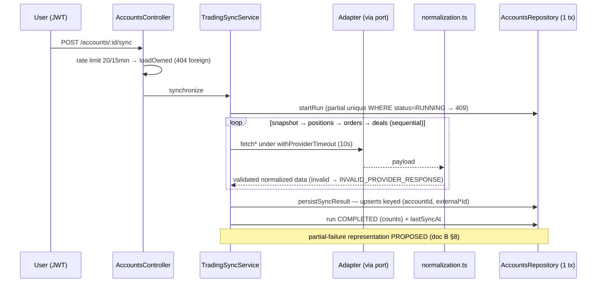

# Accounts & Trading Connectivity — Target Architecture

**Phase 01 deliverable (A of 5).** Architecture and contract design only — no implementation of provider integrations, connection lifecycle APIs, migrations, or synchronization workers in this phase.
**Inputs:** Phase 00 audit (`docs/audits/PHASE-00-ACCOUNTS-CONNECTIVITY-AUDIT.md`, HEAD `5f82266` at audit time, reconciled against working tree HEAD `3d25c29`), the Phase 01 mandate, and targeted re-verification of every load-bearing claim against the current repository (see §2.3).
**Status vocabulary:** `VERIFIED IN SOURCE` (path:line evidence), `VERIFIED BY TEST` (executed during Phase 00), `PROPOSED` (this document), `UNKNOWN` (insufficient evidence).

---

## 1. Executive Summary

Euforia's Accounts & Trading Connectivity subsystem already has a **complete, disciplined, honestly read-only backend** inside the NestJS modular monolith: a provider-adapter port that is read-only *by construction* (`apps/api/src/modules/accounts/provider.types.ts:136-161`), a capability-descriptor model, one env-gated mock adapter, AES-256-GCM credential encryption with domain-separated keys, separated account/connection/snapshot/sync-run aggregates, a transactional idempotent sync pipeline with a DB-enforced single-runner guard, 13 stable error codes with HTTP mapping, per-user rate limits, and an audit-event ledger. Its e2e suite (35/35) and unit suite (81/81) passed during Phase 00 on a real migrated Postgres test database.

The target architecture is therefore **an extension, not a rebuild**. This document freezes the existing shape as the canonical architecture, defines the boundaries that future provider adapters (OANDA, cTrader, Deriv, MT5-bridge) must respect, specifies the capability model that honest partial providers require, and closes the known gaps by *design* (documentation) rather than by premature code: a three-state capability support level (`SUPPORTED / UNSUPPORTED / UNKNOWN`), provider-aware freshness thresholds, a partial-synchronization representation, and an explicit adapter result/error semantics table.

Three architectural decisions dominate every subsequent phase:

1. **The adapter port stays read-only and small.** No execution methods exist or will exist (`provider.types.ts:9-19` red-line comment; e2e "execution red line" test). Capability-specific behavior is expressed through capability declarations + optional capability-specific interfaces, never by widening a universal interface with unsupported no-op methods.
2. **Connection lifecycle ≠ data freshness.** Two orthogonal axes, already encoded as separate enums (`packages/shared/src/schemas/trading-account.ts:42-62`) and enforced by the Phase 3 mandate. A provider outage degrades freshness, not stored account metadata; invalid credentials degrade connection state.
3. **External records are observations, not journal trades.** The three-layer separation (external provider data → normalized external records → canonical Euforia journal entities) is real in code today (`Trade` vs `TradingDeal` vs `TradingPosition`; `trade-reconstruction.service.ts:309-313` refuses to copy floating values into the journal) and must remain the inviolable boundary for all future phases.

The next steps (doc E) are the Accounts UI + hygiene (Phase 02 — backend already complete, defects cleared), then the first real adapter — OANDA v20 REST (Phase 03) — behind the existing port, with the capability model extended *at that moment* so every new contract is consumed by real code as it lands.

---

## 2. Phase 00 Evidence and Constraints

### 2.1 What Phase 00 established (condensed, full detail in the audit)

| Area | Established fact | Evidence |
|---|---|---|
| Backend Accounts module | Complete bounded context, 14 files ≈ 2,970 LOC in `apps/api/src/modules/accounts/` | `VERIFIED IN SOURCE` (audit §3) |
| Provider port | `TradingProviderAdapter` — 6 read methods, `descriptor`, **no execution methods**, timeout seam `withProviderTimeout` | `provider.types.ts:136-189` |
| Registered adapters | Exactly one: `MockTradingProviderAdapter`, env-gated, `isMock: true` | `accounts.module.ts:49,58` |
| Persistence | 7 tables from migration `20261003115414_accounts_connectivity`: `TradingAccount`, `TradingConnection`, `TradingAccountSnapshot`, `TradingPosition`, `TradingOrder`, `TradingDeal`, `TradingSyncRun` | schema.prisma:286-504 |
| Sync pipeline | Sequential snapshot→positions→orders→deals, zod normalization boundary, one transaction `persistSyncResult`, idempotent upserts keyed `(accountId, external*Id)`, partial unique index single-runner (409 `SYNC_ALREADY_RUNNING`) | `trading-sync.service.ts:186-287`, `accounts.repository.ts:364-540` |
| Errors | Adapter `ProviderError` (7 codes) → `normalizeProviderError` → 13 stable `TRADING_ERROR_CODES` with HTTP mapping | `trading-account.ts:323-350` |
| Security | AES-256-GCM vault (`v1.<iv>.<tag>.<data>`), domain-separated keys, pino redaction, `credentialsHint`-only exposure, ownership-in-WHERE everywhere, SecurityEvent audit ledger | audit §10, `aes-gcm.ts:18-40` |
| Tests | unit 81/81, e2e 35/35 incl. IDOR, secret redaction, execution red line | `VERIFIED BY TEST` (audit §11) |
| Frontend | **Zero Accounts UI**: no `/accounts` route, no nav entry, 2 dead links; web runs 100% on MSW (`API_MOCKED` default) | audit §4 |
| Real-time | API has no WS/SSE for accounts; sync triggers `INITIAL`/`MANUAL` only; no scheduler/queue deps | audit §2.2, §9 |
| Connectivity deps | **None** — no HTTP client, no SDK, no scheduler, no WS server declared in `apps/api` | audit §2.2 |

### 2.2 Constraints inherited from Phase 00 and the mandate

- **Read-only by design** — no execution commands, endpoints, or privileged abstractions (mandate §3.1; already a code invariant).
- **Evidence-based capabilities** — nothing is claimed supported without Phase 00 evidence or official documentation; unknowns stay `UNKNOWN` (mandate §3.2).
- **No premature microservices** — the NestJS monolith is the home of the Accounts domain (mandate §3.5; ADR-0001 modular monolith).
- **Existing code takes precedence** — reuse before create (mandate §3.4); the inventory in §3 applies it explicitly.
- **Debt register** — Phase 00 confirmed defects that shape the roadmap but not the architecture: Monitoring `SUCCESS` filter mismatch (`monitoring.service.ts:325,383,389`), unregistered `TradingAccountsController` (`accounts.module.ts:58`), Hub plaintext demo secrets + orphaned `WebhookSecretService`, `TradingDeal.externalPositionId` schema↔DB drift, capability gating never exercised.

### 2.3 Phase 01 reconciliation against the current repository

Every claim re-verified this phase against working tree HEAD `3d25c29`:

- `accounts.module.ts:58` → `controllers: [AccountsController, BrokerController]` — confirmed (`TradingAccountsController` still unregistered).
- `mappers.ts:92-96` → `deriveSynchronizationStatus(..., freshnessTtlMs = 15 * 60 * 1000)` — confirmed.
- `provider.types.ts` port + `ProviderError` + `withProviderTimeout` — confirmed unchanged.
- `packages/shared/src/schemas/trading-account.ts` (367 lines) — confirmed complete and unchanged; still unused by `apps/web` (no imports found in `apps/web/src`).
- `normalization.ts` boundary schemas — confirmed unchanged.
- Prisma models `TradingAccount` / `TradingSyncRun` — confirmed unchanged (uuid PKs, `@@unique([userId, providerId, externalAccountId])`, `Decimal(18,8)`, partial-unique runner guard documented in migration).

**Net result: the Phase 00 report is an accurate description of the current repository. No drift discovered; all architectural decisions below rest on verified ground.**

---

## 3. Current Architecture Inventory (evidence-based, classified)

Classifications: `REUSE` (suitable as-is) · `EXTEND` (focused extension required) · `REFACTOR` (blocks intended design) · `CREATE` (no suitable implementation) · `DEFER` (not needed in scope) · `UNSUPPORTED` (verified not supported) · `UNKNOWN` (insufficient evidence).

### 3.1 Backend

| Component | Location | Current responsibility | Status | Classification | Required change / rationale |
|---|---|---|---|---|---|
| Provider adapter port | `apps/api/src/modules/accounts/provider.types.ts:136-161` | The only provider contract the app layer depends on; 6 read methods + descriptor | Complete, read-only by construction | **REUSE** | None. Real adapters implement it as-is; session-oriented providers extend deliberately later (documented at :13-19) |
| Provider registry | `provider-registry.service.ts` | Unknown provider → 422 `UNSUPPORTED_PROVIDER`; production without mock → honest 422 on connect | Complete | **REUSE** | None |
| Mock adapter | `providers/` (env-gated) | Only registered adapter; `isMock: true`; all capabilities true | Complete | **REUSE** | Keep as demo/test fixture; never present as real connectivity |
| Normalization boundary | `normalization.ts` | Zod validation of every adapter payload; invalid → `INVALID_PROVIDER_RESPONSE` | Complete | **REUSE** | Every new adapter must route payloads through it unchanged |
| Sync service | `trading-sync.service.ts:186-287` | Sequential full-refresh sync; per-call timeout; one transaction | Complete for V1 | **EXTEND** (Phase 03+) | Partial-result representation (`PARTIAL` run status exists in enum, never produced — see doc B §8); delta cursors only if a provider requires them |
| Account service | `trading-account.service.ts` (702 LOC) | Reads, connect/test/reconnect/disconnect/sync use-cases, `loadOwned` IDOR gate, broker session assembly | Complete | **REUSE** | None |
| Repository | `accounts.repository.ts` | Only Prisma touchpoint; transactional write-set; ownership in every WHERE | Complete | **REUSE** | None |
| Error mapping | error-mapper + `TRADING_ERROR_CODES` | 7 adapter codes → 13 wire codes → HTTP mapping | Complete | **EXTEND** | Add `UNSUPPORTED_CAPABILITY` when capability gating ships (Phase 03) |
| Capability model | `trading-account.ts:99-123` | 6 boolean capabilities + `isMock` + READ_* permissions + `supportedConnectionMethods: ["API_KEY"]` | Declared, **never enforced on a call path** | **EXTEND** (Phase 03) | Three-state support level + per-capability metadata; enforcement path + `UNSUPPORTED_CAPABILITY`; method enum extension for OAuth (cTrader) / bridge (MT5) — doc B §4 |
| Credential vault | `credentials-encryption.service.ts`, `infrastructure/crypto/aes-gcm.ts` | AES-256-GCM, domain-separated keys, tamper→null | Complete; key rotation NOT implemented (`v1.` version-ready) | **REUSE** (rotation **DEFER**) | Rotation policy documented in §7; implement when a real credential lifecycle exists |
| Rate limiting | `accounts-rate-limiter.service.ts` | connect 5 / reconnect 5 / sync 20 per 15 min per user, in-memory | Complete | **REUSE** (multi-instance: **UNKNOWN**, acceptable now) | Move to shared store only when horizontally scaling |
| Scheduler / queue | absent (`@nestjs/schedule`, bullmq, ioredis not declared) | — | **CREATE** (Phase 04) | Scheduled sync + backoff; not in this phase |
| WS / SSE server | absent in API | market-service (:3003) is the only WS, separate domain | **CREATE** (Phase 04+, only if freshness demands) | §8: react-query invalidation first, push later |
| Monitoring consumption | `modules/monitoring` | Reads Accounts narrow contract; **misreports** sync health (`SUCCESS` vs `COMPLETED`) | Defective (confirmed) | **REFACTOR** (Phase 02-hygiene, one-line class) | Fix literals at `monitoring.service.ts:325,383,389` |
| Dead controller | `trading-accounts.controller.ts` (unregistered) | Richer aliases (PATCH rename, test, reconnect) | Dead surface | **REFACTOR** (Phase 02-hygiene) | Register-or-delete decision in doc C §2 |

### 3.2 Frontend (`apps/web`)

| Component | Location | Status | Classification | Required change |
|---|---|---|---|---|
| `/accounts` route, nav entry | absent | No Accounts UI exists | **CREATE** (UI phase per doc E) | Full UI phase — out of Phase 01 scope here |
| Shared contract consumption | `packages/shared/src/schemas/trading-account.ts` | Complete, UI-ready, **zero imports from web** | **REUSE** | The UI phase consumes it verbatim |
| MSW handlers for accounts contract | absent (fixture accounts ≠ trading-account contract) | Fixture chain feeds sizer/monitoring unmarked | **CREATE** + **REFACTOR** honesty markers | Mirroring handlers; demo-data markers on risk-relevant fixtures (audit HIGH risk) |
| Reusable primitives | monitoring (`StatusBadge`, `FreshnessBadge`, `MetricLine`, `ageLabel`), settings (`ConfirmDialog` + `requireTyped`), security (masked hints, `SecretOnceDialog`) | ~80% of needed primitives exist | **REUSE** | Remaining: provider picker, environment control, show-once secret input, test-checklist renderer, sync-progress row (audit §4.4) |
| Real-time integration points | `useSyncExternalStore` store pattern; `queryClient.invalidateQueries` | Established patterns | **REUSE** | Client cache invalidation on sync completion before any push transport |
| Live bridge | `NEXT_PUBLIC_API_LIVE=true` → `/api/v1` proxy :4000 | Verified working | **REUSE** | None |

### 3.3 Persistence and shared infrastructure

| Component | Status | Classification | Notes |
|---|---|---|---|
| 7 Accounts-domain tables | Migrated, 0 rows in dev DB, FK-cascading, decimal-exact | **REUSE** | See §12 for target persistence responsibilities |
| `Trade` / `TradeExecution` canonical uniqueness | `@@unique([accountId, externalRef])`, `@@unique([accountId, externalPositionId])`, `@@unique([accountId, externalDealId])` | **REUSE** | The external→canonical reconciliation keys already exist (§4.6) |
| Money representation | `Decimal(18,8)` everywhere; decimal-string wire; `Prisma.Decimal` math | **REUSE** | House convention confirmed; single `Float` (OCR confidence) is not money |
| Shared contract package | `@cosmoz/shared`, zod, source-exported, no build step | **REUSE** | Extensions designed in doc B, implemented only when consumed (mandate §19) |
| Generation-2 Integration models | `IntegrationConnection`, webhook endpoints/deliveries modeled+migrated, **wired to nothing** | **DEFER** | Wire only when a real webhook use-case lands; do not merge with Accounts domain |
| Event bus | `ADR-0002-domain-event-strategy.md` exists; no competing bus will be created | **REUSE** | Accounts emits SecurityEvent audit entries today; domain events follow ADR-0002 when needed |
| Historical snapshot series | `TradingAccountSnapshot` is latest-only upsert | **DEFER** (product decision open) | Equity-curve history is MISSING by design; decision recorded in §10 |

---

## 4. Target Architecture

The target architecture is the **current verified architecture plus explicit extension seams**. Conceptual responsibilities below are *roles*, not new modules; each maps to existing module boundaries wherever possible (mandate §7 preamble).

### 4.1 Layered view (existing vs proposed)

| Layer | Owner (module) | Exists today | Proposed additions |
|---|---|---|---|
| Provider connectivity | `modules/accounts` (adapters + registry) | Port, registry, mock adapter | Real adapters behind the same port (OANDA → cTrader → Deriv → MT5-bridge, per doc D §9); optional capability-specific interfaces |
| Capability model | shared contract + registry | 6 booleans, never enforced | Three-state support levels, per-capability metadata, enforcement path with `UNSUPPORTED_CAPABILITY` |
| Normalization | `normalization.ts` | Zod boundary for every adapter payload | Symbol/identifier mapping helpers per adapter (inside adapter boundary) |
| Sync orchestration | `trading-sync.service.ts` | Manual + initial, full refresh, single-runner guard | Partial-result representation (Phase 02); scheduler + backoff + cursors (Phase 03) |
| Persistence | `accounts.repository.ts` + 7 Prisma tables | Complete | Snapshot-history series only if product decides (§10); cursors table if a provider requires delta sync |
| Trading Core integration | `modules/trading` (reconstruction) | Deals→journal trades, idempotent, no live trigger | Live HTTP trigger as an explicit, separately-designed workflow (not in Phases 02-03) |
| Real-time distribution | none for accounts | react-query polling (15 s broker session) | Cache invalidation on sync; WS/SSE only if provider streaming justifies it (§8) |
| Frontend | `apps/web` (future `/accounts`) | Nothing | UI phase per doc E consuming shared contracts verbatim |

### 4.2 Aggregate and ownership decisions (mandate §7.1, §8)

**D1 — `TradingAccount` + `TradingConnection` remain two aggregates with a 1:1 relation, connection owned as a separate aggregate.**
Evidence: the codebase already models them separately (`schema.prisma:286-364`), disconnect wipes credentials while preserving history, and connection status is an orthogonal axis from account identity. Merging them into one aggregate would couple credential lifecycle to account identity and complicate the "disconnect ≠ delete" invariant (`tradingDisconnectResponseSchema.historyPreserved`, `trading-account.ts:266-271`). **Rejected alternative:** single aggregate (would require rewriting the disconnect semantics and e2e contract for zero behavioral gain).

**D2 — Account metadata is provider-anchored and never client-mutable** except the display label (PATCH rename only, `tradingAccountUpdateInputSchema`). Evidence: `trading-account.ts:354-366` and service comment "labels never impersonate the provider's own data".

**D3 — Snapshots are latest-only observations; positions/orders/deals are idempotently upserted external records.** Each is owned by the Accounts domain; the journal never treats them as canonical (§4.6).

**D4 — `TradingSyncRun` is the unit of synchronization truth** (status, counts, error, requestId). A run distinguishes full success from partial success once partial semantics ship (doc B §8).

**D5 — The Integration Hub is a different bounded context** (simulated) and stays one. No entity migration between Hub (`IntegrationRow`) and Accounts (`TradingConnection`); generation-2 Integration models stay unwired until a real webhook requirement exists.

### 4.3 Provider adapter strategy (mandate §7.2, §9.4)

- **Smallest viable interface.** The port keeps exactly the 6 verified read methods. New providers do not widen it; they implement it.
- **Optional capability-specific interfaces** (PROPOSED, Phase 02+): e.g. `StreamingCapableAdapter { subscribeAccountUpdates(...): Subscription }` — implemented only by adapters whose declared capabilities say so. The orchestration layer discovers them via guarded checks against declared capabilities, and never calls them otherwise. **No empty methods, no default fake responses** (mandate §9.4) — an unsupported operation is either absent from the interface or throws `UNSUPPORTED_CAPABILITY`.
- **Session-oriented providers** (MT5 bridge): the port stays stateless per call; session semantics enter as a *separate* deliberate extension when a real bridge is chosen (the codebase already documents this stance at `provider.types.ts:13-19`).
- **Adapter boundaries:** provider-specific types, symbol maps, pagination, rate-limit behavior, and error translation stay inside `providers/<adapter>/`. Nothing provider-specific crosses `normalization.ts` upward.

### 4.4 Capability model (mandate §7.3) — target semantics

- Every capability carries a **support level**: `SUPPORTED | UNSUPPORTED | UNKNOWN` (+ operational `TEMPORARILY_UNAVAILABLE` as a *sync-state*, not a capability — doc B §4).
- Capabilities may carry metadata: evidence source, limitations, required permissions, retrieval strategy (poll/stream), region/subscription conditions.
- `UNKNOWN` is never treated as `false` and never as `true`; it blocks the corresponding operation path with an honest error until evidence resolves it.
- Conditional support (account permissions, subscription tier) is represented at the connection/account scope, not globally (mandate §9.3).
- Target shape designed in doc B §4; implementation deferred to Phase 03 where it becomes consumed (mandate §19 rationale in the final report).

### 4.5 Normalization strategy (mandate §7.5)

Normalization handles: identifier formats, symbol naming, position/deal semantics (netting vs hedging), order statuses, side/direction, quantity and contract size, price/currency, timestamps and time zones, realized/unrealized P&L, commission/fees/swap, missing fields, historical completeness, provider status codes. Rules:

1. Every payload crosses `normalization.ts` zod schemas — a type-broken response is `INVALID_PROVIDER_RESPONSE`, never a corrupted row (verified behavior).
2. **No invented values**: missing → `null`; zero stays zero; unsupported stays `null` with capability metadata; stale is a freshness-axis property, never a value mutation (doc B §6, §9).
3. Provenance is preserved: `syncedAt`, `syncRunId`, external ids, and provider-side timestamps survive normalization (already in the wire contracts).
4. Symbol normalization: adapters map provider symbols to the application's instrument vocabulary where a mapping exists; unmapped symbols pass through **verbatim** with a provenance flag (PROPOSED; prevents silent wrong-symbol joins into instruments).

### 4.6 Trading Core integration boundary (mandate §7.6)

Explicit, frozen boundary:

- **Provider account snapshot ≠ provider position ≠ provider order ≠ provider deal ≠ canonical Euforia journal trade.** Five distinct concepts, five distinct stores.
- Imported records support matching, reconciliation, and journaling workflows; they **never** auto-create or auto-mutate canonical `Trade` rows except through the existing, explicitly-designed `TradeReconstructionService` pipeline (idempotent, Decimal-exact, refuses floating-value copies — `trade-reconstruction.service.ts:309-313`).
- Reconciliation keys already exist and are the only sanctioned link: `Trade @@unique([accountId, externalRef])`, `Trade @@unique([accountId, externalPositionId])`, `TradeExecution @@unique([accountId, externalDealId])` (schema, verified).
- A dedicated external↔canonical *mapping table* is **not introduced** in this phase: the unique constraints above plus `positionId` links already express the required relationships; a universal mapping entity would be speculative (mandate §8.10 "do not introduce without demonstrating the requirement"). Re-evaluate only if multi-to-many attribution proves necessary in a real import.
- Phase 01 changes no Trading Core behavior (mandate §7.6).

### 4.7 Frontend presentation boundary (mandate §7.7)

The UI consumes provider-neutral shared contracts only. It must be able to render: connected/disconnected, connection-validation state, supported account info, last successful sync, data freshness, partial sync, provider limitations, actionable errors, unsupported features, reconnection requirements. Contract mapping for each: doc B. The UI phase is out of scope here (doc E defines it).

---

## 5. Architecture Diagrams

### 5.1 Component and data-flow diagram

Legend: solid border = **exists today** (verified); dashed border = **proposed** (this document / roadmap). No proposed component is represented as existing.

```mermaid
flowchart TB
    subgraph EXT["External providers"]
        OA["OANDA v20 REST<br/>(official, token)"]
        CT["cTrader Open API<br/>(official, OAuth 2.0)"]
        DV["Deriv API<br/>(official, WebSocket)"]
        MT5["MT5 terminal / bridge<br/>(decision OPEN — doc D §8)"]
        TV["TradingView<br/>account sync UNSUPPORTED"]
    end

    subgraph PROP["proposed adapters (Phase 02+)"]
        OAD["OandaAdapter"]
        CTD["CTraderAdapter"]
        DVD["DerivAdapter"]
        MTD["Mt5BridgeAdapter"]
    end

    subgraph ACC["modules/accounts — apps/api :4000 (EXISTS)"]
        PORT["TradingProviderAdapter port<br/>READ-ONLY by construction"]
        MOCK["MockTradingProviderAdapter<br/>env-gated, isMock:true"]
        REG["ProviderRegistryService"]
        NORM["normalization.ts<br/>zod boundary"]
        SVC["TradingAccountService<br/>loadOwned + rate limits + audit"]
        SYNC["TradingSyncService<br/>1 tx persistSyncResult"]
        REPO["AccountsRepository"]
        VAULT["AES-256-GCM vault<br/>domain-separated keys"]
    end

    subgraph SIB["sibling modules (EXISTS)"]
        ID["modules/identity<br/>JWT guard + SecurityEvent ledger"]
        MON["modules/monitoring<br/>narrow read contract"]
        TC["modules/trading<br/>TradeReconstructionService"]
    end

    subgraph DB[("Postgres 17 embedded :5433 — 7 accounts tables EXIST")]
        TA[("TradingAccount")]
        TCN[("TradingConnection<br/>credentialsEnc")]
        TSA[("TradingAccountSnapshot<br/>latest-only")]
        TP[("TradingPosition / TradingOrder / TradingDeal")]
        TSR[("TradingSyncRun<br/>single-runner partial unique")]
    end

    subgraph WEB["Next.js — apps/web"]
        UI["/accounts UI — PROPOSED (doc E)"]
        RQ["react-query<br/>cache invalidation"]
        MSW["MSW worker (mock default)"]
    end

    OA -.-> OAD
    CT -.-> CTD
    DV -.-> DVD
    MT5 -.-> MTD

    OAD -.-> PORT
    CTD -.-> PORT
    DVD -.-> PORT
    MTD -.-> PORT
    MOCK --> PORT
    PORT --> REG
    REG --> SVC
    SVC --> SYNC
    SYNC --> NORM
    NORM --> REPO
    REPO --> TA & TCN & TSA & TP & TSR
    SVC --> VAULT
    SVC --> ID
    MON --> REPO
    TC --> REPO
    REPO --> RQ
    RQ --> UI
    MSW --> UI
```

### 5.2 Sync sequence (current verified shape — the template every adapter must fit)



---

## 6. Domain Boundaries

### 6.1 The required domain-boundary table (mandate §8 deliverable)

| Concept | Domain owner | Source of truth | Lifecycle | Invariants | Relationships | Existing implementation | Proposed decision |
|---|---|---|---|---|---|---|---|
| Application user | `modules/identity` | `User` | Signup → (delete cascades) | Auth principal; tenant root | owns everything below | `User` + JWT guard | **REUSE** |
| Provider (integration identity) | Accounts | Registry descriptor (code, not DB) | Static until a new adapter ships | Stable `providerId`; display names never used as identity | 1—N accounts | `TradingProviderDescriptor` | **REUSE** descriptor; **EXTEND** capability levels (doc B §4) |
| Connection | Accounts | `TradingConnection` row | `DISCONNECTED / CONNECTING / CONNECTED / ERROR` (doc B §3) | 1:1 with account; credentials wiped on disconnect; history preserved | belongs to account | schema.prisma:337-364 | **REUSE** |
| External trading account | Accounts | `TradingAccount` row | Connected → (active) / no-longer-accessible | `@@unique(userId, providerId, externalAccountId)`; currency/env provider-anchored | 1—N per user; 1 per connection (V1; multi-account discovery when a provider supports it) | schema.prisma:286-332 | **REUSE**; discovery flows **DEFER** until a provider requires them |
| Account snapshot | Accounts | `TradingAccountSnapshot` | Written per sync (latest-only) | Nullable metrics; provenance `syncedAt`+`syncRunId`; never invented | 1 latest per account | schema.prisma:369-393 | **REUSE**; historical series **DEFER** (§10) |
| External position | Accounts | `TradingPosition` | Upserted per sync | `(accountId, externalPositionId)` unique; nullable floating values | N per account; may group deals | schema.prisma | **REUSE** |
| External order | Accounts | `TradingOrder` | Upserted per sync | `(accountId, externalOrderId)` unique | N per account | schema.prisma | **REUSE** |
| External deal | Accounts | `TradingDeal` | Upserted per sync (idempotent) | `(accountId, externalDealId)` unique; symbol null = balance op | N per account; `positionId` links MT5 netting | schema.prisma | **REUSE** |
| Sync run | Accounts | `TradingSyncRun` | `RUNNING→COMPLETED/PARTIAL/FAILED` | Single-runner per account (DB partial unique); atomic write-set | belongs to account | schema.prisma:485-504 | **REUSE**; PARTIAL semantics **EXTEND** (doc B §8) |
| Sync cursor/watermark | Accounts (future) | none today | per provider+account+endpoint | never globally interchangeable | — | absent | **CREATE in Phase 03 only** if a provider requires delta sync; full-refresh is the default |
| Canonical journal trade | `modules/trading` | `Trade` | Journal workflows only | `@@unique(accountId, externalRef/externalPositionId)`; synced trades refuse MANUAL close | references external ids, never copies floating values | `modules/trading` | **REUSE** — boundary frozen (§4.6) |
| Integration Hub state | `modules/integrations` | `IntegrationRow` | Simulated demo context | Separate bounded context | none to Accounts | verified | **REUSE as-is** (simulated); generation-2 models **DEFER** |

### 6.2 Ownership rules

Each invariant is owned by exactly one module: ownership checks and lifecycle transitions by `modules/accounts` services; authentication and session revocation by `modules/identity`; journal semantics by `modules/trading`; Monitoring is a **consumer** of the Accounts narrow read contract and owns nothing in this domain; the web app presents and never authoritatively decides state.

---

## 7. Security and Read-Only Architecture (mandate §14 — summary; threat model inline)

Design rules (all verified in source today, kept as architecture invariants):

1. **Tenant isolation:** every read/write path filters by the authenticated principal (`loadOwned`, `findAccountForUser(accountId, userId)`, ownership in WHERE); connect payload carries **no** userId field. Negative tests for cross-user access and IDOR are part of the standing e2e suite (35/35).
2. **Credential storage:** AES-256-GCM at rest, domain-separated keys (`ACCOUNTS_CREDENTIALS_ENCRYPTION_KEY`), decrypted secrets visible only inside the adapter call boundary (`ProviderRequestContext`), masked `credentialsHint` only in views, pino redaction of `*.credentials/*.token/*.password/*.apiKey`, no secrets in URLs/errors/traces/analytics. **Key rotation:** not implemented; `v1.` envelope is version-ready — rotation design (key-id + re-encrypt sweep) is a documented Phase 06+ task, before any credential class other than single API keys exists.
3. **Least privilege:** V1 permission vocabulary is READ_* only and always derived from the adapter descriptor — clients can never grant permissions. Providers lacking restricted credentials (e.g. MT5 terminal login) are flagged in doc D with the risk recorded.
4. **Read-only enforcement:** the port exposes no execution methods; no schema/endpoint for order placement/modification/closure exists; the e2e "execution red line" asserts 404 on write paths. Enforcement is architectural (backend), never frontend-only (mandate §14.4).
5. **Auditability:** connection lifecycle and sync failures append to the shared `SecurityEvent` ledger without secrets (`TRADING_ACCOUNT_CONNECTED|CONNECTION_FAILED|DISCONNECTED|SYNC_FAILED`).

**Threat model (focused, per mandate §14.6):**

| Threat | Mitigation | Implemented/tested in |
|---|---|---|
| Credential theft at rest | AES-256-GCM, domain-separated keys, tamper→null | Today (`VERIFIED BY TEST`); rotation Phase 05+ |
| Credential leakage via logs/responses | pino redaction; sanitized `ProviderError` messages; e2e secret-redaction assertions | Today |
| Cross-user exposure (IDOR) | ownership-in-WHERE + principal-only flows; e2e cross-user suite | Today |
| Unauthorized realtime subscription | any future push channel must scope events per-user at the server (Phase 04+ design gate; no subscription exists today) | Gate in doc E Phase 04 |
| OAuth callback abuse (cTrader Phase 05) | state parameter + replay protection + secure token persistence — designed with the OAuth method extension, not before | doc E Phase 05 |
| Replay/duplicate event ingestion | idempotent upserts by `(accountId, external*Id)`; duplicate deals cannot create duplicate rows | Today (`VERIFIED BY TEST`) |
| Malformed/malicious provider responses | zod normalization boundary → `INVALID_PROVIDER_RESPONSE` (502), never persisted | Today |
| Provider outage → retry storms | per-user rate limits + per-call timeout + (Phase 04) scheduler backoff with cap | Partially today; completion Phase 04 |
| Accidental execution capability | port red-line comment + absence of write schemas + standing e2e red-line test; any PR touching the port must keep the test green | Today, permanent |
| Compromised external credentials | disconnect wipes secrets, preserves history; reconnection requires fresh credentials; providers' revocation documented per provider (doc D) | Today |

---

## 8. Real-Time and Synchronization Architecture (mandate §15 — summary)

- **No new event system.** ADR-0002 governs domain events; accounts currently appends to the `SecurityEvent` ledger and derives status. The first delivery mechanism for fresher UI data is **react-query cache invalidation on sync completion** — an existing, verified pattern — *not* a WebSocket (mandate §15: "do not assume all updates must be WebSocket messages").
- **Streaming vs polling:** the capability model expresses which providers stream (OANDA pricing stream, cTrader subscriptions, Deriv WS) vs poll (MT5 bridge). Polling adapters need nothing new; streaming adapters implement an optional capability-specific interface (§4.3) **only when a streaming provider phase actually begins**.
- **Event contracts (names reserved, emitted only when real emitters exist):** `connection.status_changed`, `external_account.snapshot_updated`, `external_deal.ingested`, `sync.completed`, `sync.failed` — aligned to existing domain-event conventions; every client-facing event user-scoped at the server.
- **Freshness:** provider-aware thresholds (doc B §9) replace the single hardcoded 15-min TTL; `LIVE` never means real-time for a polling provider (honesty rule carried from Phase 00).

---

## 9. Rejected Alternatives and Rationale

| Alternative | Rejected because |
|---|---|
| Separate Accounts microservice | No deployment/runtime/licensing evidence justifies it (mandate §3.5); ADR-0001 modular monolith; all verified flows are in-process |
| Single `TradingAccount` aggregate including connection+credentials | Would break disconnect-preserves-history and the connection≠freshness axis separation; zero behavioral gain |
| Universal adapter interface with streaming+discovery+session methods required for all | Forces every adapter to implement unsupported operations (mandate §9.4 forbids); contradicts "smallest viable interface" |
| Result-envelope (`NormalizedProviderResult`) as the adapter return type | The established pattern (return data / throw sanitized `ProviderError`) is tested and coherent; an envelope would create a second error mechanism competing with `ProviderError` + `normalizeProviderError`. Documented as a contract decision in doc B §10 instead of code |
| Universal external-record↔journal-trade mapping table | Requirement not demonstrated; existing unique reconciliation keys express current relationships (mandate §8.10) |
| Persisting raw provider payloads by default | Data minimization (mandate §9.6); normalized+validated records + error codes suffice for V1; retention policy would be speculative. Reserved for a debugging mode with redaction+TTL if a real need appears |
| Creating the 3-state capability model in shared code now | Would be unconsumed code (no second adapter exists) — the repo's discipline is "documented, not speculative"; design frozen in doc B §4, implementation lands with the first real adapter (mandate §19) |
| Building the Accounts UI in this phase | Mandate §20 excludes it; doc E scopes it |
| Reusing the Hub's simulated connection state for real accounts | Different bounded context (audit §6.4); merging would contaminate honesty of the real domain |

---

## 10. Architecture Risks and Unresolved Decisions

| # | Risk / decision | Impact | Disposition |
|---|---|---|---|
| R1 | **MT5 path unresolved** (terminal bridge vs third-party cloud bridge vs defer) — user decision, Phase 00 §17 | Shapes Phase 06; may introduce `PLATFORM_BRIDGE` connection method and session semantics | Blocked on user; do not design around undocumented APIs; doc D §8 |
| R2 | Provider priority (OANDA-first vs user's actual broker set) | Reorders doc D §9 | User confirmation requested |
| R3 | Historical snapshot series (equity curves) | Persistence volume vs product value | Latest-only retained; decision recorded, reversible |
| R4 | Capability gating never exercised by a real adapter | First real adapter may reveal degradation bugs late | Mitigated: capability-poor test adapter + contract tests mandated in Phase 03 (doc E) |
| R5 | Confirmed hygiene defects (monitoring literals, dead controller, dead links, plaintext Hub demo secrets, schema drift) | Not architectural; block clean UX only | Assigned to Phase 02-hygiene in doc E; nothing here depends on them |
| R6 | In-memory rate limiters (multi-instance unsafe) | Only matters at horizontal scale | Accepted now; revisit on scaling |
| R7 | `DELAYED` sync status reserved but never produced; `PARTIAL` run status same | Vocabulary/behavior gap | Semantics defined in doc B §8-§9; produced from Phase 03/04 |
| R8 | OAuth absent from `supportedConnectionMethods` | cTrader blocked until extended | Extension designed (doc B §4.4), implemented Phase 05 |

**Consistency note:** this document, doc B, doc C, doc D, and doc E were written together and cross-checked — the domain model, state names, error codes, and route proposals are identical across all five. No contradictory models exist.
