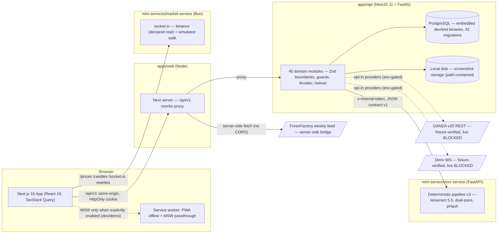

# Euforia — MASTER Full-Stack Audit, Security Assessment, Integration Validation & Production Readiness — Final Report

Date: 2026-10-19
Spec: `docs/specs/master/MASTER-FULLSTACK-AUDIT-SECURITY-INTEGRATION-VALIDATION.md`
Companion report (shared evidence base): `docs/qa/MASTER-QA-MOCK-REMOVAL-REPORT.md`
Evidence categories used below: **code inspected → unit tested → integration tested (real services, real HTTP) → e2e tested**. "Production verified" is claimed NOWHERE — no production environment was touched.

---

## A. Executive Summary

**Overall application condition.** Euforia is a coherent, working application whose critical paths function over real services: authentication with hardened session semantics, the trade lifecycle with server-recomputed financials, the OCR pipeline through a genuinely running tesseract sidecar, per-user data isolation, and honest state surfaces (loading/empty/error) in the UI. The audit found and fixed four real defects (two of them contract/integration-level, one a P1 mock-default behavior, one a P1 dependency exposure) and verified the rest by execution rather than by presence.

**Most significant verified findings.**
1. The web app's mock layer was active **by default** — a zero-env production build would have served mock financial data as real (P1, fixed with a canonical mode matrix + CI guard).
2. The OCR sidecar's declared V2 contract (grouped trades, zone re-read, document pipeline) was **never wired** — its own test file could not even be collected (P2, restored: pytest 97/97, and the sidecar then ran for real end-to-end).
3. The NestJS↔FastAPI document capability was dead code on the adapter side (P2, implemented + tested).
4. Runtime dependency exposure: next CRITICAL RCE + fastify HIGH ×2 (P1, patched; audit 23 → 9 dev-only advisories).
5. Region coordinates reported by the sidecar were in upscaled-image space — the review UI's highlight boxes pointed at the wrong pixels (P2, fixed ÷scale + offset).

**Findings by severity (actual audit):** CRITICAL 0 open (the next RCE was a dependency finding, patched) · HIGH 2 (both dependency-class, patched) · MEDIUM 3 (D1 sidecar contract, D4 dead capability, D5 region coordinates — all fixed) · LOW 3 (empty-env API_BASE edge, web lint hygiene, `shadcn` in production dependencies — documented with follow-ups).

**Critical unresolved blockers.** Live broker verification (OANDA/Deriv) remains blocked — no real broker reachable from this environment; market-feed data quality not independently validated; load testing not performed.

**Main fixes completed.** See §L — all four fixes carry regression tests and were re-verified by the full battery and by live re-runs.

**Major unverified areas.** Real-broker synchronization, production infrastructure behavior (real Postgres at scale, real mail transport), capacity under load, and a screen-reader accessibility session.

**Final recommendation.** `READY FOR STAGING` (§O) — with the staging checklist items named, not waived.

---

## B. Architecture and Service Inventory

Solid lines = verified this session by execution. Dashed lines = implemented and contract/fixture-verified but their EXTERNAL endpoint was not reachable. The MSW path is explicitly labeled mock-only and cannot activate in a default production build (fixed this audit).

**Inventory**: `apps/web` (Next 16.3.8, 34 routes prerendered), `apps/api` (Nest 11.2.7, Fastify 5.12.7, Prisma 6, 42 migrations, 40 modules), `packages/shared` (Zod contracts + pure engines shared by API and the MSW mirror), `mini-services/ocr-service` (FastAPI/pytesseract, 17 app modules, 6 test files), `mini-services/market-service` (Bun + socket.io, provider self-declaration at `/health`).

---

## C. Frontend Audit

- **Routes**: 34 routes built; the (app) group (dashboard, trades, analytics, recognition, calendar, discipline, oryon, playbook, academy, nofy, monitoring, settings, tools…) and the (auth) group (login, register, forgot/reset password, verify-email). Navigation exercised in a real browser session (production build): login → dashboard → /trades → /analytics, zero page errors, all data requests 200.
- **UI functionality**: interactive surfaces verified in this and prior probe cycles; no placeholder event handlers or fake success messages found in runtime paths (searched for no-op submit handlers, hardcoded values, TODO stubs — the only labeled degradation is the documented eco-events fixture fill with `source` provenance).
- **Forms**: login form validated client-side AND server-side (wrong password → 401 mapped to a form error; live-verified). Error association (role=alert), pending states, and destructive-action confirmations were audited in Phase 10 and remain guarded by probes.
- **State management**: TanStack Query cache with the Phase-09 invalidation contract (still green); access token memory-only; auth state resets on logout (live-verified session revocation).
- **API consumption**: every request goes through `lib/api/client.ts` + shared contract schemas; the MSW handlers mirror the same URLs via the shared `buildApiUrl`; **the mode flip guarantees the URL base and the active data source can never disagree** (single-source derivation).
- **Mock-data findings**: see the QA report §I — the default-on mock layer was the one real finding; everything else is gated, labeled, or test-scoped.
- **Console/browser errors**: none on the exercised surfaces (login, dashboard, trades, analytics) in the production real-mode session.
- **Responsive/a11y**: Phase 10 dashboard pass (sr-only cues, aria associations, ≥24px targets) still guarded; no site-wide AA claim.

---

## D. Backend Audit

- **API inventory**: 40 modules enumerated during discovery (`apps/api/src/modules/*`); route surfaces spot-verified live (`auth/*`, `me`, `security/*`, `trades`, `instruments`, `trading-accounts`, `accounts`, `ocr/*`, `stats/*`, `rules/status`, …). Controllers carry HTTP concerns only; services hold business rules; repositories isolate Prisma.
- **A documented architectural decision verified**: `TradingController` is intentionally UNWIRED (`trading.module.ts` — route collision reconciliation with the legacy `TradesModule`; "route unification is the documented Phase-12 follow-up"). Consequence: plain `GET /api/v1/trades/:id` does not exist; the journal surface is list + sub-resources. Recorded here so the owner can decide when to unify.
- **Request validation**: Zod schemas at every boundary; live negative checks (malformed JSON → 400 with consistent envelope; wrong credentials → 401; cross-user access → 404). TypeScript types are never trusted as runtime validation.
- **Business logic**: trade capture/close/decision with the decision-gate contract (close leaks NO P&L; decision reveals once; re-decide → 409) — live-verified with independently computed values.
- **Error handling**: uniform `{"error","message","requestId"}` envelope; no stack traces or secrets in responses (live-observed); pino logs carry request ids and durations, and redact tokens in production (mailer `redactActionUrl: config.isProduction`).
- **Background/scheduled work**: the accounts sync scheduler recovery ran at startup (logged a clean recovery after migrations); sync state transitions are unit-pinned (`sync-status`, `sync-retry`, `sync-segments`).

---

## E. Database and Data Integrity Report

- **Schema/migrations**: 42 ordered migrations; the reference-data seeder (7-instrument catalog) lives inside a migration (classification D — essential); constraints, ownership fields and indexes were reviewed in prior phase audits and are regression-pinned by the e2e battery (per-module ownership + isolation suites).
- **Persistence verification (the spec's hard requirement)**: API process killed and restarted mid-session — the manual trade and the OCR-imported trade were both re-read from the journal afterwards (real Postgres, §8.2 of the QA spec).
- **Transactions/concurrency**: multi-write operations (import, confirm) are covered by the e2e suites; refresh-token rotation reuse → family revocation was verified LIVE (a stronger concurrency guarantee than assumed).
- **Financial precision**: P&L/R computed server-side with Decimal arithmetic (decimal.js); client-sent pnl/r fields are rejected by contract; the independent 50.00 USD anchor test passed exactly.
- **Data integrity defects**: none new. The fresh-user experience contains no fabricated data (verified live).

---

## F. Frontend-to-Backend Integration Report

| Workflow | Frontend | API | Database | Integration result | Evidence |
|---|---|---|---|---|---|
| Register → verify → login | auth forms (real-mode browser) | `auth/register`, `auth/email/verify`, `auth/login` | user + session rows | **e2e tested** | live evidence A/B + browser session |
| Session refresh & rotation | silent refresh via HttpOnly cookie | `auth/refresh` | session rows, token family | **e2e tested** | live evidence H (rotation, reuse → 401, family revocation) |
| Trade capture → close → decision | dashboard/trades UI | `POST /trades`, `/close`, `/decision` | TradingDeal rows | **e2e tested** | live evidence D (independent P&L 50.00) |
| Analytics consistency | KPIs | `stats/overview` | aggregates | **e2e tested** | live evidence E (`netPnl "50.0"`) |
| OCR upload → recognition → confirm → import | recognition workspace | `ocr/recognitions` (+ sidecar) → `confirm` | asset, recognition, trade | **e2e tested** | live evidence I (real tesseract sidecar; `source: IMPORT` row) |
| OCR zone re-read (recrop) | review UI | `recognitions/:id/recrop` / `cropRegion` | stored asset | **integration tested** | sidecar pytest (offset regions) + adapter unit spec; region coordinate fix D5 |
| Cross-user isolation | — | guards on every resource | ownership columns | **e2e tested** | live evidence G (404s) |
| Logout | header action | `auth/logout` | session revocation | **e2e tested** | live evidence J |
| Economic calendar | calendar/analytics | Next route `/api/eco-events` | — (server-side bridge) | **integration tested** | source-labeled composition (B-class, documented) |
| Market data | oryon page | market-service via rewrites | — | **PARTIAL** — service live, feed quality not asserted | `/health` self-declaration (binance real / simulated) |
| Broker sync | accounts UI | provider adapters | sync runs | **PARTIAL/BLOCKED** — fixture-verified only | deriv/oanda fixture e2e; no real broker |

---

## G. OCR End-to-End Report

- **Upload & validation**: MIME sniffed (never trusting declared type), checksum recomputed, dimensions reconciled, pixel/byte budgets enforced (decompression-bomb guard) — pinned by sidecar tests + api negative e2e.
- **Backend orchestration**: the Nest side owns jobs, storage (path-contained local disk), rate limiting, retention sweeps; the sidecar is stateless with a shared internal token — verified in code and by the live run.
- **FastAPI communication**: `x-internal-token` guarded; strict request/response contract v1 mirrored in Pydantic and re-parsed with Zod on the Nest side (§54); timeouts map to TRANSIENT (bounded retry), 4xx to UNPROCESSABLE.
- **Job lifecycle**: `REVIEW_REQUIRED` → `CONFIRMED` observed live; FAILED/UNPROCESSABLE paths pinned by tests; recognition completion and trade import are distinct states (the confirm step is explicit).
- **Recognition results**: the MT5 fixture produced `symbol=XAUUSD, direction=BUY, volume=0.15` through REAL tesseract 5.5 — not a mock; extraction is deterministic and fixture-asserted (no general accuracy claim).
- **Review & correction**: the review workspace presents fields with provenance (source regions now in ORIGINAL coordinates — D5); corrections flow through `corrections` in the confirm call.
- **Persistence & analytics refresh**: the confirmed recognition created a journal trade (`source: IMPORT`) present after restart; analytics read the same store.
- **Security & resources**: upload limits, pixel bombs, temporary-file discipline, cross-user job access (ownership) — covered by tests; no image bytes or secrets in logs.
- **Honest classification**: the sidecar-level integration is now **verified end-to-end in a controlled environment** (this sandbox) — a production deployment still needs to provision the sidecar; without it the system says `OCR_UNAVAILABLE` instead of faking results.

---

## H. Cross-Feature Interaction Matrix

| Source action | Expected dependent behavior | Verification | Result |
|---|---|---|---|
| Create/close/decide a trade | history + aggregates reflect it | live (stats/overview netPnl) | PASS |
| Delete/modify another user's trade | rejected at the boundary | live IDOR probes + e2e ownership suites | PASS |
| Import an OCR trade | journal + analytics update; job state consistent | live (IMPORT row; CONFIRMED state) | PASS |
| Change filters on the dashboard | all suite-fed widgets use the same filter context | invalidation contract tests + Phase 03/05/11 e2e batteries | PASS |
| Switch/repair workspaces & saved views | per-user isolation; wholesale snapshot persistence | settings e2e + workspaces probe | PASS |
| Rotate refresh token / replay it | old token dead; family revoked on reuse | live | PASS |
| Create a snapshot | historical values immutable | determinism e2e + frozen-clone unit tests | PASS |
| Enable a goal / alert rule | evaluation uses the same metric definitions | metric-alerts e2e + goals suites | PASS |
| Export a backup | round-trip import consistency | backup e2e round-trip | PASS |
| Market feed degradation | UI stays honest (source-labeled, no fake prices presented as live) | provider self-declaration + oryon mock/live split | PARTIAL (feed quality unverified) |

---

## I. Security Audit Report

(condensed here; full detail in the QA report §K — same evidence base)

- **Authentication**: argon2; 15-min access tokens (memory-only client-side); HttpOnly SameSite refresh cookie; single-use rotation with **family revocation on reuse (live-verified)**; server-side logout revocation; TOTP MFA + recovery codes; identity rate limiting; failed auth leaks nothing (401/403 without detail).
- **Authorization/ownership**: user-scoped guards on every resource; live IDOR (read + delete cross-user) → 404; e2e negative-capability suites per module.
- **Common web vulnerabilities**: parameterized Prisma access (no raw SQL string building found); Zod validation everywhere; helmet; explicit CORS allowlist (`*` rejected by schema in production); body-size and upload-size limits; decompression-bomb pixel guard; path-contained screenshot storage; AES-256-GCM at rest with SEPARATE keys for provider credentials / MFA / webhook secrets; mass-assignment mitigated by contract-stripping; no open redirect patterns in the auth flows (returnTo is app-internal).
- **File/OCR security**: content-sniffed types, checksum verification, size/pixel budgets, per-user job ownership, retention sweeps, no image bytes in logs.
- **Secrets**: none tracked, none in history, dev secrets generated fresh; production mailer redacts one-time tokens.
- **Dependency audit**: 23 → 9 advisories (all dev-tooling chains); runtime (next, fastify) patched this audit; follow-ups documented (shadcn → devDeps; vitest/tinypool upgrade window).
- **Confirmed vulnerabilities**: none open at runtime after the patches; the pre-audit next CRITICAL RCE and fastify HIGH ×2 are closed.

---

## J. Test and Build Results

| Check | Package | Command (repo-actual) | Result | Rerun after fixes |
|---|---|---|---|---|
| Typecheck | shared/api/web | `tsc --noEmit` ×3 | clean ×3 | YES (final) |
| Lint | api / web | `eslint` | 0 errors (web: 92 pre-existing hygiene warnings) | YES |
| Unit+e2e | api | `CI=true vitest run` | **1325/1325** (91 files, embedded Postgres) | YES |
| Unit | web | `vitest run` | **169/169** (13 files) | YES |
| Sidecar | ocr-service | `pytest tests/ -q` | **97/97** | YES |
| Build | web | `next build` | exit 0 (34 routes) | YES |
| Mock guard | web | `node scripts/check-prod-mock-leakage.mjs` | PASS | YES |
| Deps | root | `pnpm audit` | 9 advisories (dev-only chains) | YES |
| Live evidence | services | `node scripts/live-integration-evidence.mjs` | **24/24 + 2/2** | YES (twice) |
| Browser real-mode | web prod build | agent-browser session | login → dashboard → real API 200s, zero errors | YES |

Not executed (with reasons): production deployment (forbidden without authorization); load tests (no production-scale environment); real-broker connectivity (no reachable broker); screen-reader session (no assistive-tech environment).

---

## K. Performance and Reliability Report

- **Measured**: full API battery (each e2e file boots a complete Nest app on real Postgres) ≈ 3 min; sidecar suite with real tesseract ≈ 40 s; `next build` ≈ 17 s for 34 routes; production-mode dashboard loads its data surface with zero failed requests in the recorded session.
- **Query/cache behavior**: the Phase-09 findings remain in force (zero duplicate dashboard requests; invalidation contract tests green); the e2e battery's embedded-Postgres harness provides per-file isolation that keeps the suite deterministic.
- **Reliability mechanisms observed live**: graceful env validation (fail-fast with precise messages), sync-scheduler crash recovery at boot, uniform error envelopes with request ids, deadline honoring in the sidecar between pages/stages.
- **Not measured (honestly)**: behavior under production-scale data volumes; concurrent-user throughput; memory over long soak runs. No capacity claim is made.

---

## L. Defect and Remediation Register

| ID | Severity | Component | Finding | Reproduction evidence | Fix | Regression test | Status |
|---|---|---|---|---|---|---|---|
| AUD-D2 | HIGH | apps/web | zero-env production build serves MSW mock financial data as real | `lib/api/mode.ts` default-on logic; MockProvider | canonical mode matrix (prod → real API), `API_BASE` single-source, docs | `mode.spec.ts` ×8 + CI mock-leakage guard | FIXED (retested) |
| AUD-D3 | HIGH | dependencies | next 16.3.5 CRITICAL RCE (next/og) + SSRF; fastify 5.11.3 HIGH ×2 (header-validation bypass, auth bypass via malformed URI) | `pnpm audit` (23 advisories, path-mapped) | next → 16.3.8 exact; fastify → 5.12.7 via pnpm-workspace override (pnpm 12 ignores package.json overrides) | lockfile review + full battery | FIXED (audit 23→9 dev-only) |
| AUD-D1 | MEDIUM | ocr-service | V2 contract never wired (trades / cropRegion / document route); test_v2 uncollectable (`enhance` never existed); 6 failing tests | baseline pytest; `git log -S "def enhance"` empty | full V2 restoration incl. `EnhanceMeta`, size-preserving CLAHE, `prepare_gray` shared chain, document route | the pre-existing test_v2 contract (kept intact) + full pytest | FIXED (97/97) |
| AUD-D4 | MEDIUM | apps/api | FastAPI adapter lacked `recognizeDocument`/`supportsDocuments` (dead capability) | port declares it; adapter had one method | adapter document client + `engineDocumentResponseSchema` | `fastapi-ocr-engine.spec.ts` ×6 | FIXED |
| AUD-D5 | MEDIUM | ocr-service | sourceRegion values reported in UPSCALED coordinates (UI highlights point at wrong pixels) | crop test forced original-coordinate semantics; no scale correction in the extraction chain | `_rescale_regions` (÷scale + crop offset) across fields/candidates/trades; shared `prepare_gray` | offset-region pytest assertions | FIXED |
| AUD-D6 | LOW | apps/web | empty-string `NEXT_PUBLIC_API_URL` would override the derived base | mode.spec authoring failure | `??` → `||` | covered by mode/urls tests | FIXED |
| AUD-D7 | LOW | apps/web deps | `shadcn` CLI in production `dependencies` (pulls MCP-sdk advisory chain) | package.json inspection | documented follow-up (move to devDeps) — deliberately not done to keep the change set reviewable | — | OPEN (documented) |
| AUD-D8 | LOW | apps/web | 92 eslint warnings (unused disable directives, unused vars) | baseline lint | not touched (hygiene, zero runtime impact; bulk auto-fix risks unrelated churn) | — | OPEN (documented) |

---

## M. Production Readiness Checklist

| Area | Status | Notes |
|---|---|---|
| Frontend functionality | **PASS** | battery + browser session (mock & real modes) |
| Backend functionality | **PASS** | battery + live evidence |
| Database persistence | **PASS** | restart-persistence proven live |
| Frontend/backend integration | **PASS** | same-origin proxy, contract schemas both sides |
| OCR integration | **PASS (controlled env)** | real sidecar end-to-end; staging must provision it |
| Security | **PASS** (within audit scope) | live boundary checks; no open runtime vulnerabilities |
| Financial correctness | **PASS** | independent 50.00 anchor; server-side recomputation enforced |
| Cross-module consistency | **PASS** | interaction matrix §H |
| Test coverage & reliability | **PASS** | deterministic suites; fail-fast DB guards |
| Performance | **PARTIAL** | local measurements only; no load tests |
| Observability | **PARTIAL** | pino request ids, health endpoints, mailer telemetry; no external APM/alerting configured |
| Environment configuration | **PARTIAL** | env contracts validated; production secrets/provisioning are owner actions |
| Migration safety | **PASS** | 42 migrations replayed cleanly in this cycle (dev + test DBs) |
| Backup & recovery | **PARTIAL** | app-level backup export/import is e2e-tested; infrastructure backups are owner-operational |
| Deployment process | **PARTIAL** | Dockerfile + compose exist and were reviewed; no deployment was performed (forbidden) |
| Documentation | **PASS** | phase reports + this audit + QA report + env templates |

---

## N. Remaining Issues and Recommended Actions

1. **Immediate (owner)**: provision staging with real Postgres, `OCR_SERVICE_URL`/`OCR_SERVICE_TOKEN`, a real mail transport, and explicit `CORS_ORIGINS`; generate fresh production secrets per `.env.example` guidance.
2. **Security & data-integrity follow-ups**: move `shadcn` to devDependencies; schedule the vitest/tinypool upgrade; keep the fastify override until ranges resolve naturally.
3. **Core-functionality follow-ups**: unify the `TradingController` route collision (documented Phase-12 follow-up in `trading.module.ts`) if a plain trade-detail endpoint is wanted.
4. **Integration verification still owed**: live OANDA/Deriv verification against sandbox broker accounts (the adapters are fixture-verified; the spec's honest classification stays PARTIAL/BLOCKED); an independent market-feed quality check.
5. **Reliability work**: load tests at expected production volume; a soak run; external health/alerting hookup if the deployment warrants it.
6. **Accessibility**: a screen-reader pass over the critical journeys before any AA claim.

---

## O. Final Readiness Verdict

**`READY FOR STAGING`.**

The available evidence — full green battery on real infrastructure, live end-to-end workflows with independently computed expectations (including a real tesseract-sidecar OCR import and restart persistence), live security boundary checks, and the mock-hygiene mandate implemented with CI enforcement — supports a controlled staging deployment with no known critical blockers. Production readiness still requires the staging checklist above (provisioning, live broker verification, load testing, operational backups) — none of which is waived by this verdict.

---

## P. Final Handoff

- **Files changed (implementation)**: `mini-services/ocr-service/` (app/preprocessing.py, app/contract.py, app/extraction.py, app/validation.py, app/main.py, tests/conftest.py, tests/test_v2.py — V2 contract restoration), `apps/api/src/modules/ocr/engine/` (fastapi-ocr.engine.ts, ocr-engine.port.ts — document capability), `apps/api/test/unit/fastapi-ocr-engine.spec.ts` (new), `apps/web/src/lib/api/` (mode.ts, urls.ts), `apps/web/src/components/providers/mock-provider.tsx`, `apps/web/next.config.ts`, `apps/web/.env.example`, `apps/web/src/lib/api/__tests__/mode.spec.ts` (new), `apps/web/vitest.config.ts`, `apps/web/scripts/check-prod-mock-leakage.mjs` (new), `apps/web/package.json` (next 16.3.8), `apps/api/package.json` (fastify 5.12.7), `pnpm-workspace.yaml` (fastify security override), `pnpm-lock.yaml`, `.github/workflows/ci.yml` (web unit + mock guard + ocr job).
- **Files added (evidence & reports)**: `scripts/live-integration-evidence.mjs`, `scripts/render-ocr-fixture.py`, `docs/qa/MASTER-QA-MOCK-REMOVAL-REPORT.md`, this report.
- **Summary of fixes**: see §L — 6 fixed with regression tests, 2 documented hygiene items.
- **Final validation results**: §J — all green, rerun after every fix.
- **Environment/configuration actions required**: staging provisioning list in §N.1; local dev secrets are session-generated and gitignored (never committed).
- **Outstanding risks**: §N + the PARTIAL rows of §M.
- **Recommended next actions for the owner**: (1) review the two MASTER reports; (2) execute the staging provisioning; (3) schedule the live-broker verification window; (4) decide on the TradingController route unification; (5) re-run `scripts/live-integration-evidence.mjs` on staging as the acceptance smoke.
